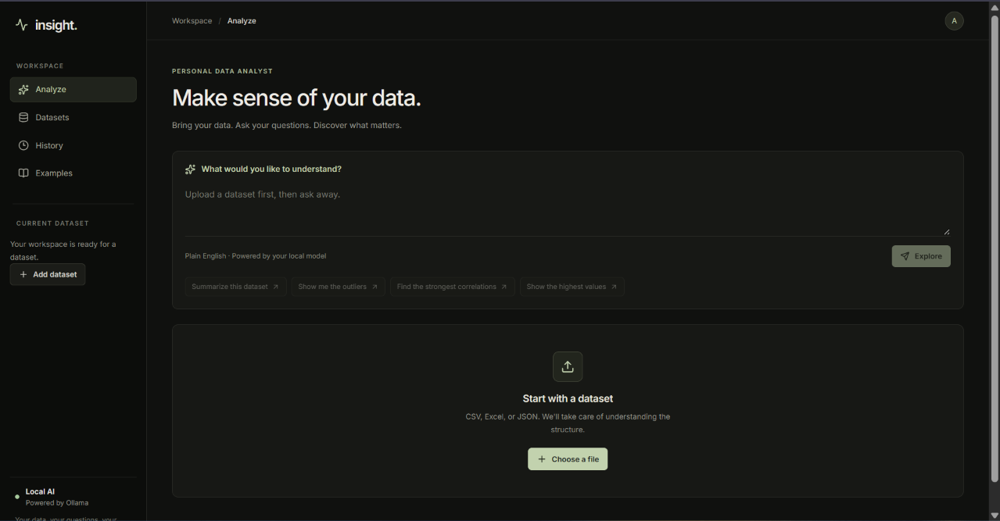
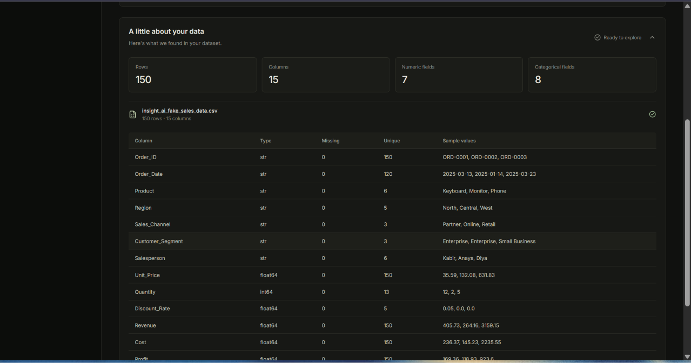
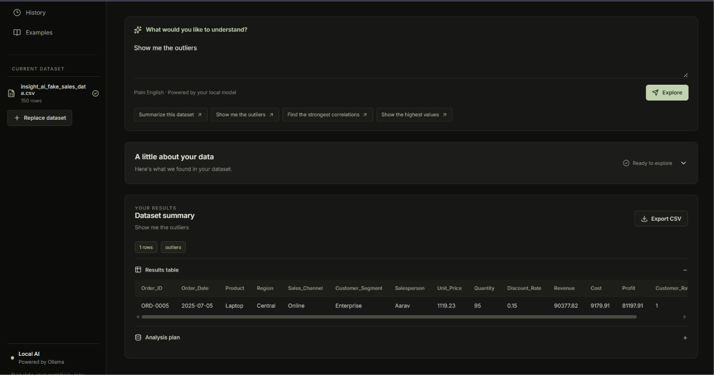
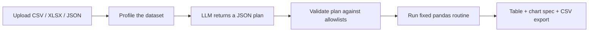

# insight. — Personal Data Analyst

> Upload a CSV, Excel or JSON file, ask a question in plain English, and get back a table, a chart spec and a CSV export. No pandas required.

**Live demo:** https://data-insight-ai-indol.vercel.app/



---

## Features

- **Plain-English questions.** Ask things like "Show me the outliers" or "Average profit by region".
- **Automatic dataset profiling.** Row and column counts, numeric vs categorical fields, missing values, unique counts and sample values, shown as soon as a file is uploaded.
- **Safe by design.** The LLM never writes or runs code. It only returns a small JSON plan, which the backend validates against allowlists before running a fixed pandas routine.
- **Transparent results.** Every answer shows the result table and the analysis plan the model chose, so you can see exactly what was run.
- **Charts.** Group-by results are drawn as a bar chart above the results table.
- **Session workspace.** The Datasets, History and Examples pages show what you've loaded and asked in the current session, and let you reuse a past question.
- **CSV export.** Download any result as a CSV.
- **Guardrails.** File type, file size, row and column limits are enforced on upload.

## Screenshots

| Upload and profile | Ask and get results |
| --- | --- |
|  |  |

## How it works



1. **Ingest.** The file is read into a pandas DataFrame and checked against size, row, column and column-name rules.
2. **Profile.** The backend builds a profile of the data: dtypes, missing counts, unique counts, up to three sample values per column, and the lists of numeric and categorical columns.
3. **Plan.** The profile and your question are sent to an LLM (Groq), which must answer with a JSON plan: one operation plus its parameters. It is told never to return Python or SQL.
4. **Validate.** The plan is checked: the operation, operator and aggregation must be on the allowlists, and every column must exist in the dataset. Anything unexpected is rejected or replaced with a safe default.
5. **Execute.** A hand-written pandas routine for that operation runs, and the result is returned with a preview (up to 200 rows) and a lightweight chart spec.

### Why a plan instead of generated code?

Letting a model write and execute Python against user uploads is risky. Constraining it to a fixed set of operations keeps results predictable and removes a whole class of prompt-injection problems. The trade-off is that it can only do what the operations support.

## What you can ask

| Operation | Example question | What it does |
| --- | --- | --- |
| `describe` | "Summarize this dataset" | Dataset overview (dtype, missing, unique), or descriptive stats for one column |
| `outliers` | "Show me the outliers" | Rows where a numeric column has a z-score above 3 in absolute value, with a histogram spec |
| `filter` | "Show orders where Revenue is above 5000" | One condition using `>`, `>=`, `<`, `<=`, `==` or `!=` |
| `groupby` | "Average profit by region" | `mean`, `sum`, `count`, `min` or `max` of a numeric column per category, with a bar chart spec |
| `correlation` | "Find the strongest correlations" | Correlation of two numeric columns, or the full numeric correlation matrix |
| `sort` | "Show the highest values" | Top 10 rows by a column, ascending or descending, with a bar chart spec |

Requests outside these operations fall back to `describe`, and the model explains the limitation.

## Tech stack

| Layer | Technology |
| --- | --- |
| Frontend | React, Vite, Recharts, lucide-react; deployed on Vercel |
| Backend | Python, FastAPI, Uvicorn |
| Data | pandas, NumPy, openpyxl |
| LLM | Groq API (default model `openai/gpt-oss-120b`) via httpx |

## Project structure

```text
data-insight-ai/
├── backend/
│   ├── main.py            # FastAPI app: upload, analyze and export endpoints
│   ├── analyst.py         # Profiling, LLM planning, plan validation and execution
│   └── requirements.txt
├── frontend/
│   ├── public/
│   ├── src/
│   │   ├── App.jsx        # Workspace UI: upload, query, results, history
│   │   ├── App.css
│   │   ├── index.css
│   │   └── main.jsx
│   ├── index.html
│   ├── package.json
│   ├── vite.config.js
│   └── eslint.config.js
└── docs/
    └── screenshots/
```

## Getting started

### Prerequisites

- Python 3.10+
- Node.js 18+
- A [Groq API key](https://console.groq.com/)

### 1. Backend

```bash
cd backend
python -m venv .venv
source .venv/bin/activate        # Windows: .venv\Scripts\activate
pip install -r requirements.txt

export GROQ_API_KEY="your-key"   # Windows PowerShell: $env:GROQ_API_KEY="your-key"
uvicorn main:app --reload
```

The API runs at `http://localhost:8000`, with interactive docs at `http://localhost:8000/docs`.

### 2. Frontend

```bash
cd frontend
npm install
npm run dev
```

The app runs at `http://localhost:5173`, which is the backend's default allowed origin. With no configuration it talks to the backend at `http://localhost:8000/api`. To use a different backend, set `VITE_API_URL` (see [Configuration](#configuration)).

## Configuration

These are environment variables for the **backend**:

| Variable | Required | Default | Description |
| --- | --- | --- | --- |
| `GROQ_API_KEY` | Yes | none | Groq API key used to generate analysis plans |
| `GROQ_MODEL` | No | `openai/gpt-oss-120b` | Groq model used for planning |
| `FRONTEND_URLS` | No | `http://localhost:5173` | Comma-separated list of allowed CORS origins, with no trailing slash. Set this to your deployed frontend URL in production |

And for the **frontend** (Vite reads these at build time):

| Variable | Required | Default | Description |
| --- | --- | --- | --- |
| `VITE_API_URL` | No | `http://localhost:8000/api` | Base URL of the backend API. It must include the `/api` suffix, for example `https://your-backend.example.com/api` |

## API reference

| Method | Endpoint | Description |
| --- | --- | --- |
| `GET` | `/app/health` | Health check, returns `{"status": "ok"}` |
| `POST` | `/api/upload` | Upload a dataset (`multipart/form-data`, field `file`). Returns `dataset_id`, `filename`, `profile`, `preview`, `rows`, `columns` |
| `POST` | `/api/analyze/{dataset_id}` | Body: `{"question": "..."}`. Returns the `plan`, `profile`, `result_columns`, `rows_returned`, `preview`, `chart`, `truncated` and a `result_id` |
| `GET` | `/api/export/{result_id}` | Download the result preview as `analysis.csv` |

Example:

```bash
# 1. Upload a dataset
curl -F "file=@sales.csv" http://localhost:8000/api/upload

# 2. Ask a question using the returned dataset_id
curl -X POST http://localhost:8000/api/analyze/<dataset_id> \
  -H "Content-Type: application/json" \
  -d '{"question": "Show me the outliers"}'

# 3. Export the result using the returned result_id
curl -o analysis.csv http://localhost:8000/api/export/<result_id>
```

## Limits

| Limit | Value |
| --- | --- |
| Accepted file types | `.csv`, `.xlsx`, `.json` |
| Max file size | 20 MB |
| Max rows | 100,000 |
| Max columns | 200 (column names must be unique) |
| Max question length | 10,000 characters via the API (1,000 in the UI) |
| Rows returned in a result | 200 (a `truncated` flag is set if there are more) |

## Privacy

Your full dataset stays on the backend. To plan an analysis, the following is sent to Groq: the dataset profile (column names, dtypes, missing and unique counts, and up to three sample values per column) and your question. Don't upload data you aren't comfortable sharing that much of with a third-party API.

## Deployment

- **Backend:** any host that can run Uvicorn (the project is set up for Render). Use `backend/` as the root directory, `pip install -r requirements.txt` as the build command and `uvicorn main:app --host 0.0.0.0 --port $PORT` as the start command. Set `GROQ_API_KEY` and `FRONTEND_URLS`.
- **Frontend:** Vercel, with `frontend/` as the root directory. Set `VITE_API_URL` to `https://<your-backend-host>/api` and redeploy, because Vite bakes the value in at build time.
- **CORS:** set the backend's `FRONTEND_URLS` to the exact frontend origin, for example `https://data-insight-ai-indol.vercel.app` (no trailing slash).

## Known limitations and roadmap

- [ ] Uploaded datasets and results are held in memory, so they are lost on restart and not shared between workers. Add expiry and persistent storage.
- [ ] Add rate limiting and authentication so the public endpoint can't exhaust the LLM quota.
- [ ] Render the outlier histogram and the top-10 sort chart. The API returns specs for them, but the UI currently draws only group-by bar charts.
- [ ] Support multi-condition filters and multi-step questions.
- [ ] Add time-based grouping (by month or year) for date columns.
- [ ] Add an IQR-based outlier option alongside the z-score method.
- [ ] Export the full result, not just the 200-row preview.
- [ ] Add automated tests for plan validation and execution.

## Author

Built by [Abhinav Kumar](https://github.com/Abhinav001-glitch).